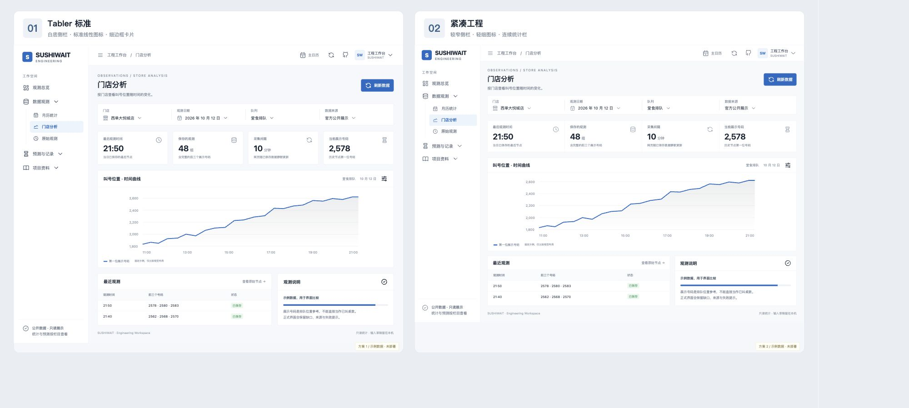
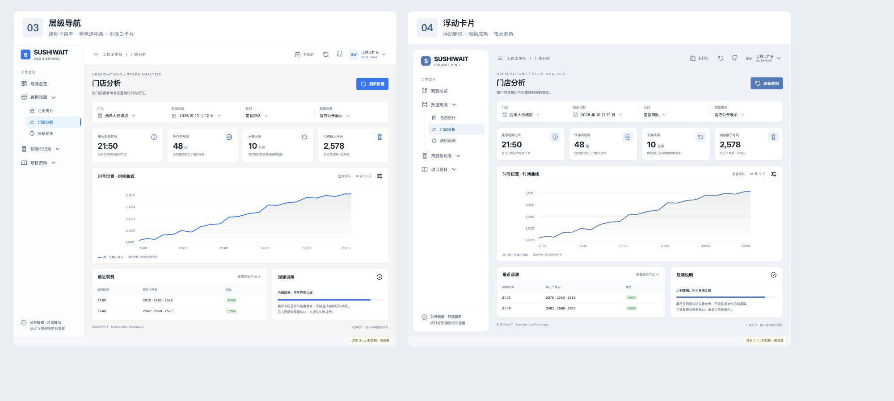
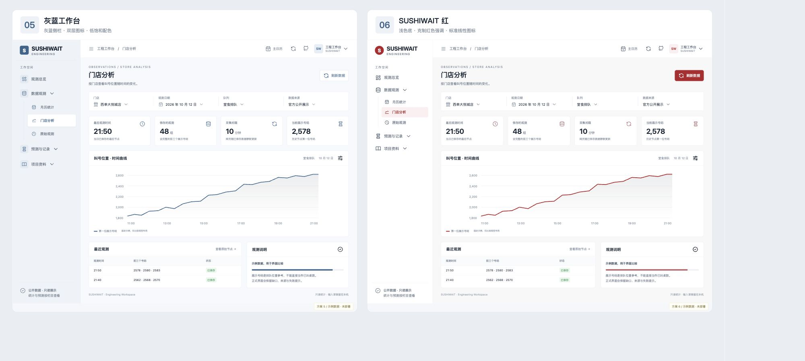
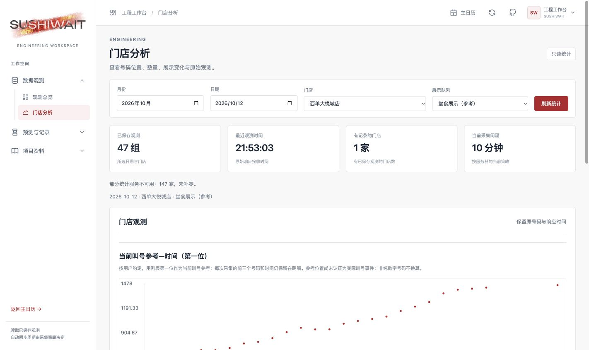

# 工程页设计参考与内容分类

2026-10-13 · R64–R66／E0477–E0480。主日历继续作为日常查看入口；时钟链接的`/statistics-legacy`是开发与维护工程页。

2026-10-13 · E0483：工程页归档读取提示按官方／早期来源分别显示，缺口保留，不能把月份归档可读状态当作实时采集健康。[实际部署截图](previews/engineering-20261013/deployed-archive-status.png)。

## 用户选择

采用Tabler免费核心版的白底卡片、细边框和简洁后台布局，导航放左侧。Tabler官方说明核心版免费／MIT，支持侧栏布局；本项目以原创本地CSS参考其组织方式，不安装收费包、不复制Pro素材、不引入外部CDN。Ant Design Pro是用户指定的备用参考。工程页仅浅色；主日历现有视觉保持。

## 六种官方参考

| 名称 | 官方示例 |
| --- | --- |
| Tabler | https://preview.tabler.io/ |
| AdminLTE | https://adminlte.io/themes/v4/ |
| CoreUI | https://coreui.io/demos/bootstrap/latest/free/?theme=light |
| Ant Design Pro | https://preview.pro.ant.design/dashboard/analysis |
| SB Admin | https://startbootstrap.com/previews/sb-admin |
| PatternFly | https://www.patternfly.org/components/table/html/ |

许可依据：[Tabler官方说明](https://tabler.io/admin-template)、[MIT许可证](https://github.com/tabler/tabler/blob/dev/LICENSE)。六种实际网页参考截图仅留本机，未当作本项目公开素材。

## 分类与共享筛选

| 左侧栏目 | 内容 |
| --- | --- |
| 观测总览 | 月历、所选日期门店观测汇总、覆盖及失败状态 |
| 门店分析 | 单店第一位号码位置、原始数量、展示变化、最近原始观测 |
| 预测实验 | 本人已有号码、实际取号时间、到店计划、历史／实时参考与资料不足原因 |
| 用餐记录 | 正常用餐事件时间、本机私有草稿、下载与恢复 |

一次只展示一个栏目；月份、日期、门店、队列与记录集共享。导航切换不清空输入或草稿，不触发上游采集，不销毁已加载内容。没有选门店时显示选择提示；不同数据来源的曲线和模型历史仍分别处理。手机窄屏导航与筛选排列在页面上方，避免遮住数据。

## 实施阶段

第一轮四分类已部署到原`/statistics-legacy`地址。相关28项Python检查、8个历史客户端场景、桌面输入保留与390px无横向溢出检查通过；真实西单10-12历史返回47组。六组曾作为独立示例比较。用户已选06浅色红色，实际四分类、下拉分组、图标和顶栏现已接线并上线；示例中的固定数据不进入生产。

## 六组完整页面比较 · E0479

[交互式大图预览](previews/engineering-20261013/index.html)可从本机静态服务器打开，也可直接打开HTML；所有示例数据固定，不调用门店接口或改生产服务。可组合布局、导航和图标。

| 编号 | 方案 | 主要区别 |
| --- | --- | --- |
| 01 | Tabler标准 | 最接近官方纵向示例；白侧栏、标准线性图标、细边框 |
| 02 | 紧凑工程 | 较窄导航、轻细图标、连续统计栏 |
| 03 | 层级导航 | Ant式子菜单组织，Tabler图标，蓝色选中条 |
| 04 | 浮动卡片 | 浮动侧栏、图标底色、较大圆角 |
| 05 | 灰蓝工作台 | 浅灰蓝侧栏、双层图标、低饱和配色 |
| 06 | SUSHIWAIT红 | 克制红色强调、浅色底、标准线性图标 |

参考：[官方纵向布局](https://preview.tabler.io/layout-vertical.html)、[浮动侧栏](https://preview.tabler.io/layout-vertical-floating.html)、[Tabler Icons](https://tabler.io/icons)。图标文件保留[MIT许可](previews/engineering-20261013/TABLER-ICONS-LICENSE.txt)及[下载来源与摘要](previews/engineering-20261013/icon-sources.json)。布局为本项目原创；没有安装Tabler框架或收费素材，不能把预览里的新菜单算作已接线功能。

## 当前选定与上线效果 · E0480

采用06：白底卡片与侧栏、细边框、深红强调；观测数据与预测／记录分组展开，项目资料为真实仓库链接。共享筛选位于内容区；切换保留输入与本机草稿。右上角链接主日历、GitHub、界面说明与版本记录，刷新读取原有已保存副本，不增加门店采集。

SVG直接使用[仓库正式浅色标志](../../assets/sushiwait-logo-light.svg)，运行资源`engineering-logo.svg`与其逐字一致。保持viewBox比例，桌面容器内适配原画布留白，手机尺寸经390px检查。字形、笔触与OFL归属见[资产说明](../../assets/NOTICE.md)。源码候选rc84，部署为原展示库加资源及静态路由补丁，云采集未升级或重启。
